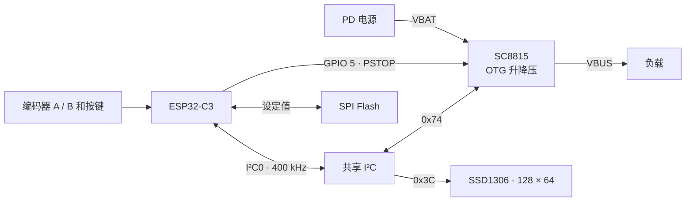
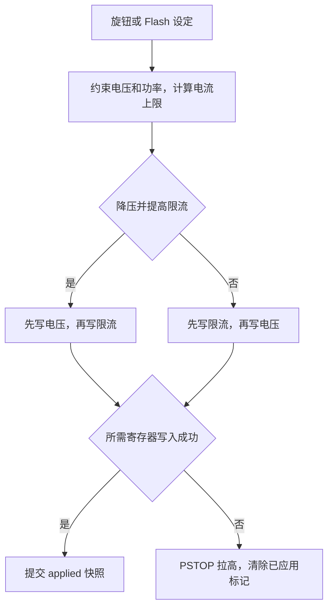
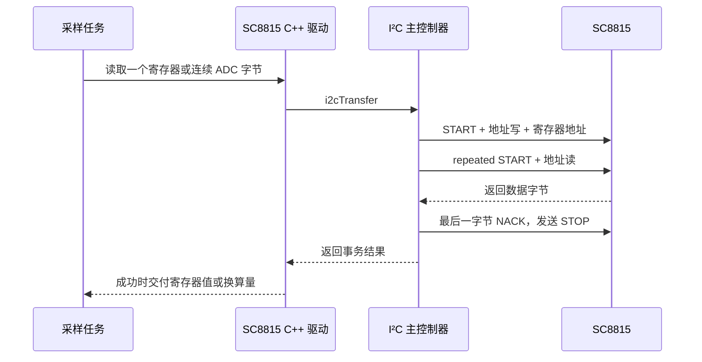
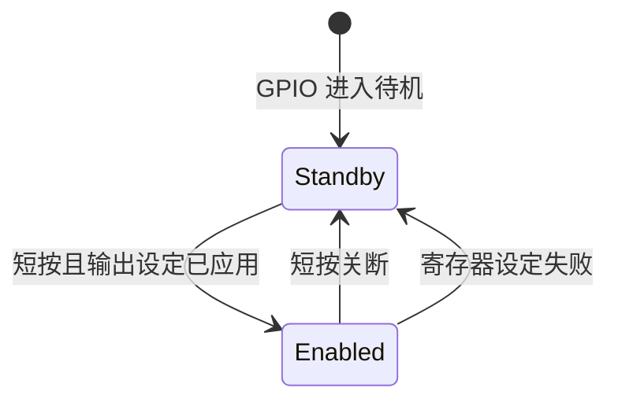
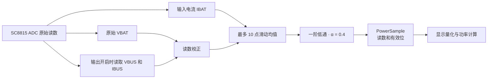

# SC8815 电源固件工作原理

- [硬件与代码结构](#硬件与代码结构)
- [启动时序](#启动时序)
- [FreeRTOS 任务与中断](#freertos-任务与中断)
- [输出设定与寄存器](#输出设定与寄存器)
- [采样和输出状态](#采样和输出状态)
- [编码器与显示](#编码器与显示)
- [设定保存](#设定保存)
- [上板观测点](#上板观测点)

## 硬件与代码结构

PD 电源进入 SC8815 的 VBAT 端，SC8815 以 OTG 模式向 VBUS 端输出。SC8815 按外部反馈网络和芯片寄存器执行开关控制。ESP32-C3 负责设定参考电压与限流、读取芯片 ADC，并通过 PSTOP 控制输出。



| 信号 | 配置 | 作用 |
| --- | --- | --- |
| 编码器 A / B | GPIO 2 / 3，输入上拉，双边沿中断 | 正交解码和计步 |
| 按键 | GPIO 4，输入上拉，每 10 ms 轮询，低电平按下 | 输出开关、调节项切换、按住旋转 |
| PSTOP | GPIO 5，输出 | 高电平待机，低电平使能 |
| I²C SDA / SCL | GPIO 8 / 9，I²C0，400 kHz | SC8815 和 OLED 共用 |
| 采样与反馈 | RS1、RS2 均为 10 mΩ，反馈倍率 13.5 | 电流换算与外部 VBUS 参考设置 |

| 源码 | 职责 |
| --- | --- |
| [partitions.csv](../partitions.csv) | 应用和 NVS 的 Flash 分区 |
| [src/main.cpp](../src/main.cpp) | 硬件初始化和任务创建 |
| [src/task_context.h](../src/task_context.h) | 四个任务命名空间、任务入口与共享运行状态 |
| [src/board_config.h](../src/board_config.h) | 引脚、校正、限值和芯片板级配置 |
| [src/i2c.cpp](../src/i2c.cpp) | I²C0 设备、总线互斥和事务超时 |
| [src/power_supply.cpp](../src/power_supply.cpp) | 电压电流采样、校正、滤波及采样状态复位 |
| [src/input.cpp](../src/input.cpp) | 编码器中断、按键轮询、设定约束、寄存器写入及 PSTOP 控制 |
| [src/screen.cpp](../src/screen.cpp) | SSD1306 初始化、仪表刷新任务和分块传输 |
| [src/settings.cpp](../src/settings.cpp) | 通过 Preferences 加载输出设定，以及定期保存任务 |
| [components/preferences](../components/preferences/CMakeLists.txt) | 独立的 Espressif Preferences 库组件 |
| [components/sc8815/sc8815.cpp](../components/sc8815/sc8815.cpp) | 探测、寄存器事务、配置编码与 ADC 换算 |

固件及 SC8815 驱动使用 C++20 或以上标准。驱动通过调用方提供的传输函数引用访问芯片，寄存器和采样结果通过引用输出。传输的读写缓冲区使用 `std::span`，两个缓冲区均为空时发送地址探测。板级代码通过 ESP-IDF 配置 I²C 主控制器和 GPIO。

## 启动时序

1. ROM 启动 ESP-IDF 引导程序，引导程序读取分区表并加载应用。ESP-IDF 初始化运行环境和 FreeRTOS。
2. `app_main()` 等待 1 s，初始化 I²C0 和 OLED，发送启动画面，再等待 1 s。OLED 初始化或启动画面发送失败时记录日志。
3. 读取并约束电压、限流和功率设定。`InputTask::powerInitialize()` 拉高 PSTOP，在待机状态配置 SC8815 并写入输出设定。
4. 配置编码器中断和按键输入，再创建共享状态互斥锁及四项任务。SC8815 初始化失败时保持待机并记录失败步骤。

## FreeRTOS 任务与中断

| 任务 | 优先级 | 触发 | 职责 |
| --- | --- | --- | --- |
| `power_sample` | 5 | 每 50 ms | 采样 VBAT 和 IBAT，输出开启时采样 VBUS 和 IBUS |
| `user_input` | 4 | 每 10 ms | 取走编码器累计步数并读取按键电平，执行手势判定和寄存器写入 |
| `oled_display` | 3 | 每 100 ms | 直接读取运行状态并绘制，每个数据事务最多传输 30 字节像素 |
| `settings_save` | 2 | 每 500 ms | 待保存设定的静默期超过 2000 ms 后，通过 Preferences 提交整组设定 |

ESP32-C3 单核运行，FreeRTOS 节拍为 1 kHz，每项任务的栈分配为 4096 字节。周期任务直接调用 `xTaskDelayUntil()`，按 FreeRTOS 的固定周期基准调度。`esp_timer` 提供手势计时和保存静默期计时。编码器 ISR 位于 IRAM，正交转移表位于 DRAM。

采样、输入和显示通过支持优先级继承的互斥锁访问运行状态。显示任务持锁直接读取电源和输入状态，绘制完成后释放锁并发送 OLED 帧。总线互斥锁按 I²C 事务获取和释放，因此 SC8815 的访问可以穿插在 OLED 数据块之间。

保存任务每 500 ms 在状态锁内检查待保存标记和设定变更时间，并在提交完成后释放状态锁。采样和输入共用同一个状态锁，I²C 超时和 NVS 写入会影响实际调度间隔。

## 输出设定与寄存器

| 参数 | 设定约束 |
| --- | --- |
| 电压 | 2600–25600 mV，旋钮每步 100 mV，默认 5000 mV |
| 电流 | 下限 300 mA，旋钮每步 100 mA，默认 1000 mA |
| IBUS 限流量程 | 6 倍检测倍率、10 mΩ 采样电阻，满量程 6000 mA |
| 功率上限 | 20–100 W，步进 10 W，默认 100 W |
| 功率换算的电流上限 | 由设定电压和功率计算，向下量化到 500 mA 的整数倍 |

`normalizeSettings()` 先限制电压和功率，再计算电流的最终上限。所有量使用整数单位计算，避免旋钮步进累积浮点误差。

```text
功率电流上限(mA) = floor(功率(W) × 1 000 000 / 电压(mV) / 500) × 500
最终电流上限     = min(功率电流上限, IBUS 限流满量程)
```

例如设定 20 V、100 W 时，电流上限为 5 A。设定 12 V、100 W 时，电流上限为 IBUS 满量程 6 A。功率设定通过约束写入芯片的限流值生效，屏幕显示的实时功率由输出电压和电流的滤波读数相乘。



`powerApply()` 对比 `applied_settings`，只写入发生变化的电压和电流。降压同时提高限流时先降压，其余情况按限流优先处理。任何所需写入失败都会关闭输出并清除已应用标志。

### 寄存器事务与物理量换算

| 对象 | 访问和计算 |
| --- | --- |
| VBUS 外部参考 `0x03–0x04` | 按反馈倍率 13.5、命令增益 1.005490 和 −22.26 mV 偏移反算，四舍五入到 2 mV 参考步进，并约束在代码允许的 2–2048 mV。驱动用 `ref_mv / 2 - 1` 编码，把低寄存器保留位合并后连续写两个字节。 |
| IBUS 限流 `0x05` | 读取 `RATIO`，按 6 倍比例和 10 mΩ 采样电阻换算，板级量程为 6 A。驱动对 `I × 256 / 6 - 1` 进行寄存器量化。 |
| ADC `0x0D–0x16` | 高位和低位在一次连续读内取得，采用 `(高字节 << 2) + (低字节 >> 6) + 1` 计算步数。板级 VBUS / VBAT 比率为 12.5 倍，对应 25 mV/步。板级 IBUS 使用 6 倍比率与 10 mΩ 的 RS1，对应 0.01 A/步。 |
| 状态与掩码 `0x17 / 0x19` | 状态读取会清除 INDET。配置掩码时保留指定的保留位，并将 bit 0 写为 1。 |

板级配置采用 300 kHz 开关频率、20 ns 死区、2 mV/µs 的 VBUS 指令斜率，以及 `LOOP_SET=IMPROVE`。



驱动将寄存器地址与写入字节放在同一次写事务中，I²C 驱动为事务设置 2 ms 软件超时。一次应用操作可能包含多次事务，例如限流写入需要先读比例。固件中的编码允许范围与板上实际可用输出范围应分别按代码和硬件测量理解。

## 采样和输出状态





原始 VBUS 乘以 1.01217，原始 VBAT 乘以 1.00972，IBUS 加上 −0.020 A 后以零为下限。各通道独立维护滤波窗口和低通值，首个有效样本初始化低通状态。VBUS 和 VBAT 四舍五入为整数毫伏，并限幅至 0–65535 mV。关断时清除 VBUS / IBUS 的有效位与滤波状态，VBAT 和 IBAT 可在待机状态显示。采样周期为 50 ms。

## 编码器与显示

编码器 ISR 通过 ESP-IDF 的 `gpio_get_level()` 依次读取 A、B 两相，使用正交转移表累计四分之一步。相邻状态往返会抵消，观测到两位变化时从当前 AB 状态重新同步。累计到正负四分之四时，读取当时的按键电平将步数归入普通步数或功率步数。

输入任务每 10 ms 在同一临界区读取按键电平、旋转标记和累计步数。GPIO 中断在按住时记录编码器边沿，旋转标记保留到松开，按压时长由采样时间计算。

| 操作 | 行为 |
| --- | --- |
| 普通旋转 | 修改选中的电压或电流，随后重新计算设定范围 |
| 按住旋转 | 修改功率上限。输入任务在旋转标志置位期间刷新显示计时，最后一次刷新后约 1200 ms 恢复仪表显示。旋转后抑制本次尚未触发的按键事件 |
| 短按 | 静止按压不足 1000 ms，松开时切换输出状态 |
| 长按 | 静止按住达到 1000 ms 时自动切换一次电压和电流调节项 |

OLED 使用 `frame[128][8]` 帧缓冲，按列和页索引，每个字节包含同列的 8 个垂直像素。前三行的大字读数统一左对齐，设定电压、限流值和 CV/CC 模式分别在对应行的右下方以小字右对齐。底行左侧显示输入电压，右侧显示输入电流。电压和电流读数保留两位小数，输出功率由滤波电压和电流相乘，显示到 0.1 W。输出开启且两项读数有效时，比较读数距各自已应用设定的相对差值。电流差值较小显示 CC，其余显示 CV。失效读数使用占位内容。SSD1306 使用水平寻址，先设置完整列和页地址窗口，再按页优先顺序分块写入 1024 字节像素，每个数据事务包含一个控制字节。

## 设定保存

输入任务每次实际改变电压、限流或功率上限时，记录变更时间并置位待保存标记。保存任务每 500 ms 检查一次，当标记置位且距最近一次变更超过 2000 ms 时提交当前设定。写入成功后清除标记，写入失败则在下一轮重试。

ESP-IDF 初始化默认 NVS 分区，应用通过 `Preferences` 访问 `sc8815` 命名空间。电压 mV、限流 mA 和功率上限 W 分别使用 `setmvolts`、`setmCurrs` 和 `powerLimitW` 三个 32 位无符号键。保存任务依次写入并分别提交三项。全部写入成功后清除待保存标志，失败时保留标志供后续重试。

启动时逐项读取键值，缺失项使用板级默认值。载入的设定统一经过 `InputTask::normalizeSettings()`。

工程将 [Espressif Preferences 3.3.7](https://github.com/espressif/arduino-esp32/tree/3.3.7/libraries/Preferences/src) 作为独立 ESP-IDF 组件编译，由 [适配头](../components/preferences/upstream/Arduino.h) 提供所需的字符串类型和日志接口。

| Flash 地址 | 用途 |
| --- | --- |
| `0x000000–0x007FFF` | ESP-IDF 引导程序，DIO、40 MHz |
| `0x008000–0x008FFF` | 分区表 |
| `0x009000–0x00DFFF` | NVS，存储 `sc8815` 命名空间下的输出设定 |
| `0x010000–0x14FFFF` | 工厂应用分区 |

## 上板观测点

| 观测对象 | 触发与检查 |
| --- | --- |
| 启动与输出 | 测量 GPIO 5 和 VBUS，确认电源初始化时 PSTOP 拉高，待机期间保持高电平。 |
| I²C | 测量 GPIO 8 / 9，检查 400 kHz 总线、SC8815 重复起始和 SSD1306 分块传输。 |
| 编码器与显示 | 快速旋转和按住旋转，核对步进、按键手势、显示和采样时序。 |
| 配置保存 | 分别在待机和输出开启时调节设定，静默超过 2000 ms 并等到下一次保存检查后重启，核对三项设定。 |

使用 [README](../README.md) 的命令构建或烧录。发布镜像分别写入引导程序、分区表和工厂应用区域，保留 NVS 区域。PlatformIO 构建产物位于 `.pio/build/esp32-c3-devkitc-02/`。
